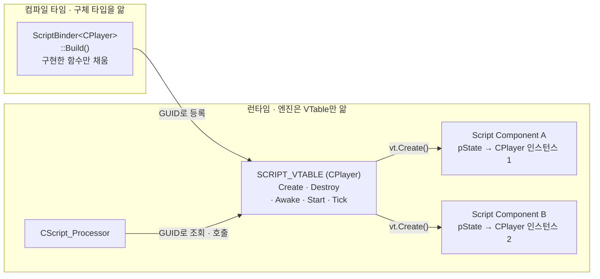
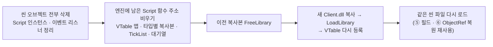

# 스크립트 페이지 초안 (2026-10-11)

노션 `원본 | 정지연 | …` 복사본에 옮길 초안이다. 표시 규칙:
- `[토글]` = 노션 토글 블록 (제목 줄이 토글 제목, 안쪽이 내용)
- `[콜아웃]` = 노션 콜아웃
- `[이미지]` = 기존 이미지 유지 또는 새로 찍을 화면
- 섹션 제목은 DOD 페이지처럼 `gray_bg` 배경의 제목 3

---

# A. 간단 페이지 (프로젝트 페이지 안의 해당 부분만 교체)

## A-1. "직접 구현한 것" 표의 게임 로직 행

| 영역 | 직접 구현한 것 |
|---|---|
| **게임 로직** | Script 컴포넌트 (GUID 기반 생성, 코드 자동 생성, 필드 리플렉션, **에디터를 끄지 않는 핫 리로드**) |

## A-2. 📜 콜아웃 전체 교체

### Unity식 스크립트 작업 흐름과 핫 리로드

[이미지] Script 한 줄 수정 → Client만 빌드 → 에디터에서 Hot Reload → 바뀐 동작 (움직이는 화면 1장)

- 에디터에서 Script를 만들면 소스 파일 · 등록 코드 · VS 프로젝트 등록까지 자동으로 처리하고, 빌드 후 **버튼 한 번으로 에디터를 끄지 않고 반영**
- 엔진은 게임 쪽 Script 타입을 모른 채 GUID로 생성하고, **구현한 생명주기 함수만** 호출 (전투 씬 프레임당 Tick 호출 534회 → 92회)
- 매크로 리플렉션으로 Inspector 필드를 편집 · 저장하고, 오브젝트 참조는 UUID로 저장해 씬 로드 후 복원

상세 보기 → (상세 페이지 링크)

---

# B. 상세 페이지 (전체 교체)

제목 제안: **Unity식 Script 컴포넌트와 핫 리로드**
(기존 제목 "Script Component 기반 게임 로직 확장 구조"를 유지해도 된다.)

[콜아웃 📌]
### 엔진이 게임 Script를 모른 채 생성 · 실행 · 저장하고, 에디터를 끄지 않고 교체하는 구조

[콜아웃 🔗 회색 · 안쪽]
**흐름**
1. 출발점: 엔진은 게임 쪽 Script 클래스를 알 수 없음
2. 설계: GUID로 찾는 함수 묶음(VTable)으로 생성 · 삭제
3. 설계: `.script` 에셋에서 등록 코드 자동 생성
4. 설계: 구현한 단계만 도는 TickList
5. 설계: 매크로 리플렉션으로 Inspector 필드 저장 · 복원
6. 설계가 만든 문제: 오브젝트 참조는 Handle로 저장할 수 없음 → UUID 저장 후 로드 마지막에 변환
7. 확장: 핫 리로드 (Client DLL 교체 + 같은 씬 재로드)
8. 핫 리로드가 만든 문제: 남은 함수 주소, PDB 잠금, 새 파일 미등록
9. 한계

---

### ① 출발점: 엔진은 게임 Script를 모른다

Script 컴포넌트는 Unity의 MonoBehaviour처럼 게임 로직을 담는 컴포넌트입니다. 문제는 의존 방향이었습니다. `CPlayer`, `CNormalTitan` 같은 Script 클래스는 Client 프로젝트에 있고, 엔진(Engine.dll)은 Client를 참조하지 않습니다. 엔진은 이 클래스들을 include할 수 없는데도, 씬 파일을 읽을 때 정확한 타입의 인스턴스를 만들어야 했습니다.

생명주기 호출(Update 등)은 virtual로도 해결할 수 있지만, **생성은 virtual로 해결할 수 없습니다.** 호출할 객체가 아직 없기 때문입니다. 그래서 타입마다 생성 함수를 미리 등록해 두고, 씬 파일에 저장된 GUID로 찾아 호출하는 구조가 필요했습니다.

---

### ② 설계: GUID로 찾는 Script VTable

[이미지] 기존 맨 위 이미지 유지

Script 타입마다 함수 포인터 묶음 `SCRIPT_VTABLE`(Create · Destroy · Awake · Start · Tick)을 두고, 구체 타입을 아는 `ScriptBinder<TScript>`가 컴파일 타임에 채웁니다. 엔진은 런타임에 GUID로 VTable을 찾아 `Create()`를 호출할 뿐, `CPlayer`라는 이름을 알 필요가 없습니다.

- VTable은 **타입당 하나를 공유**하고, 실제 상태(`pState`)는 Script 컴포넌트마다 **따로 생성**됩니다. 함수는 타입당 하나이고, 어느 인스턴스를 처리할지는 `pState`가 정합니다.
- 생명주기 함수는 virtual이 아닙니다. `ScriptBinder`가 C++20 `requires`로 **클래스가 함수를 구현했는지 검사**해, 구현한 것만 VTable에 채웁니다.



[토글] **소스 코드 : 구현한 함수만 VTable에 채우는 Binder**
```c++
// Engine/Public/Script_Register.h

template <typename TScript>
void* Script_Create() { return new TScript{}; }

template <typename TScript>
void Script_Destroy(void* pState) { delete static_cast<TScript*>(pState); }

// 엔진이 부르는 공통 서명(void*) → 구체 타입으로 되돌려 호출
template <typename TScript>
void Script_Tick_Update(void* pState, SCRIPT_CTX& tCTX, _float fDT)
{
    static_cast<TScript*>(pState)->Update(&tCTX, fDT);
}
// Script_Awake, Script_Start, Script_Tick_Priority, Script_Tick_Late도 같은 패턴 (생략)

template <typename TScript>
void Fill_VTable_Default(SCRIPT_VTABLE& vt)
{
    vt.Create  = &Script_Create<TScript>;
    vt.Destroy = &Script_Destroy<TScript>;

    // 클래스가 구현한 함수만 채운다. 비어 있는 단계는 TickList에 들어가지 않는다.
    if constexpr (requires(TScript& s, void* pCtx) { s.Awake(pCtx); })
        vt.Awake = &Script_Awake<TScript>;
    if constexpr (requires(TScript& s, void* pCtx) { s.Start(pCtx); })
        vt.Start = &Script_Start<TScript>;

    if constexpr (requires(TScript& s, SCRIPT_CTX* c, _float dt) { s.Priority_Update(c, dt); })
        vt.Tick[(uint8_t)SCRIPT_TICK::PRIORITY] = &Script_Tick_Priority<TScript>;
    if constexpr (requires(TScript& s, SCRIPT_CTX* c, _float dt) { s.Update(c, dt); })
        vt.Tick[(uint8_t)SCRIPT_TICK::UPDATE]   = &Script_Tick_Update<TScript>;
    if constexpr (requires(TScript& s, SCRIPT_CTX* c, _float dt) { s.Late_Update(c, dt); })
        vt.Tick[(uint8_t)SCRIPT_TICK::LATE]     = &Script_Tick_Late<TScript>;
}

template <typename TScript>
struct ScriptBinder
{
    static SCRIPT_VTABLE Build()
    {
        SCRIPT_VTABLE vt{};
        Fill_VTable_Default<TScript>(vt);
        return vt;
    }
};
```

[토글] **소스 코드 : 씬 로드 때 GUID로 VTable을 찾아 인스턴스 생성**
(기존 페이지의 `SCRIPT_DATA`, `SCRIPT_VTABLE`, `Initialize_From_Spec`, `Create_State_If_Needed` 코드 유지)

---

### ③ 설계: `.script` 에셋과 자동 등록

[이미지] 기존 3장 유지

[콜아웃]
1️⃣ **에디터에서 Script 생성**
- 이름 확정 → `.script`, `.h`, `.cpp`, 클래스 템플릿, GUID/meta 생성
- **Client 프로젝트(.vcxproj)에 새 파일 등록**, 등록 코드(`Script_Registry.gen.cpp`) 갱신

2️⃣ **빌드**
- 생성된 등록 코드가 `ScriptBinder<CNewScript>::Build()`로 VTable을 만들어 GUID와 함께 등록

3️⃣ **에디터에서 Hot Reload** (⑦)
- 에디터를 끄지 않고 새 Script를 바로 씬에 붙일 수 있음

현재 게임의 Script 35개가 이 경로로 등록됩니다. 등록 코드는 내용이 바뀌었을 때만 다시 써서, 바뀐 것이 없으면 다시 컴파일되지 않습니다.

[토글] **소스 코드 : .script 에셋 자동 등록 파이프라인**
(기존 코드 유지. 생성 코드 끝에 아래 줄이 추가됨)
```c++
// Client/Private/Script_Registry.gen.cpp (자동 생성)
// Client.dll 경계 : Editor는 GetProcAddress, Game은 import로 이 이름을 찾는다
extern "C" __declspec(dllexport) void Client_Register_AllScripts() { Client::Register_AllScripts(); }
```

---

### ④ 설계: 구현한 단계만 도는 TickList

Script는 `Awake`, `Start`, `Priority_Update`, `Update`, `Late_Update` 생명주기를 가집니다.

- **문제**: 매 프레임 Script 풀 전체를 순회하면, 빈 칸과 꺼진 Script까지 단계마다 확인합니다. 또한 생명주기를 virtual 기본 구현(빈 함수)으로 두면, 아무 일도 하지 않는 Script도 매 프레임 세 번씩 호출됩니다.
- **해결**: 실행 단계별로 `(핸들, 함수 포인터)` 목록을 유지합니다. Script가 켜질 때 **구현한 단계의 목록에만** 넣고, 꺼질 때 뺍니다. 프레임 루프는 이 목록만 순회합니다.
- **호출 순서**: Awake는 생성 시 대기열에 넣었다가 다음 프레임 시작에 호출하고, Start는 별도 대기열에서 첫 Tick 전에 한 번만 호출합니다. 생성 직후 다른 오브젝트가 아직 준비되지 않은 상태에서 로직이 도는 것을 막는 순서입니다.
- **효과**: 전투 씬 기준 Script 183개 중 히트박스 · 허트박스처럼 매 프레임 할 일이 없는 Script가 대부분이라, 프레임당 Tick 호출이 **534회 → 92회**로 줄었습니다.

| | Priority | Update | Late | 합계 |
|---|---|---|---|---|
| 변경 전 (모든 Script가 세 목록에 등록) | 178 | 178 | 178 | 534 |
| 변경 후 (구현한 단계만) | 21 | 20 | 51 | 92 |

<span color="gray">켜진 Script 178개 기준. 빈 함수 호출이 줄어든 것이라 프레임 시간 차이는 측정 오차 수준입니다.</span>

[토글] **소스 코드 : TickList로 실행 구조 분리**
```c++
// Engine/Public/Script_Processor.h
struct TICK_CALL
{
    COMPONENT_HANDLE hScript{};
    ScriptTickFn     fn{};
};
std::vector<TICK_CALL> m_Ticks[(uint8_t)SCRIPT_TICK::END];
```
```c++
// Engine/Private/Script_Processor.cpp
void CScript_Processor::Add_To_TickLists(COMPONENT_HANDLE hScript, const SCRIPT_DATA& tData)
{
    const auto& vt = m_Types[tData.iTypeID].vt;
    for (uint8_t i = 0; i < (uint8_t)SCRIPT_TICK::END; ++i)
    {
        if (!vt.Tick[i])   // 구현하지 않은 단계는 목록에 넣지 않는다
            continue;
        m_Ticks[i].push_back(TICK_CALL{ hScript, vt.Tick[i] });
    }
}

void CScript_Processor::Update(float fDT)
{
    Flush_PendingAwake();
    Flush_PendingStart();   // Awake가 끝난 Script만 Start → 첫 Tick 전에 한 번

    for (auto& tick : m_Ticks[(uint8_t)SCRIPT_TICK::PRIORITY])
    {
        SCRIPT_DATA* pData = m_Pool.Get_Data_By_Handle(tick.hScript);
        if (!pData || !pData->bEnable || !(pData->iFlags & SCRIPT_FLAG_STARTED))
            continue;
        tick.fn(pData->pState, m_ctx, fDT);
    }
    // UPDATE, LATE도 같은 방식 (생략)
}
```

---

### ⑤ 설계: 매크로 리플렉션으로 Inspector 필드 저장 · 복원

[이미지] 기존 Inspector 이미지 유지

C++에는 런타임 리플렉션이 없어서, 매크로로 필드 이름 · 타입 · 클래스 내 offset을 등록하는 방식으로 대신했습니다. 저장할 때는 offset으로 실제 멤버 위치를 찾아 JSON으로 기록합니다.

[토글] **소스 코드 : Script 필드 구조**
(기존 코드 유지: `SCRIPT_FIELD_DESC`, `SCRIPT_FIELDS_BEGIN` 매크로, `Get_Field_Ptr`, `Save_Exposed_Fields`)

---

### ⑥ 설계가 만든 문제: 오브젝트 참조 저장

- **문제**: `OBJECT_HANDLE`은 런타임 생성 순서에 따라 값이 달라져, 그대로 저장하면 씬을 다시 불러왔을 때 같은 오브젝트를 가리킨다는 보장이 없습니다.
- **해결**: `SCRIPT_OBJECT_REF`에 **저장용 UUID**와 **실행용 Handle**을 함께 둡니다. 파일에는 UUID만 기록합니다.
- **로드 순서**
  1. UUID만 복원하고 Handle은 비워 둠
  2. 씬의 모든 GameObject 생성, UUID-Handle 등록, 부모 연결, 컴포넌트 값 적용
  3. 마지막에 `Resolve_Exposed_ObjectRefs()`로 UUID를 현재 Handle로 변환

저장은 바뀌지 않는 UUID로, 실행은 빠른 Handle로 역할을 나눴습니다. 이 구조는 ⑦ 핫 리로드에서 씬을 다시 불러올 때도 그대로 쓰입니다.

[토글] **소스 코드 : ObjectRef 저장 · 복원**
(기존 코드 유지)

---

### ⑦ 확장: 핫 리로드

[이미지] Hot Reload 버튼 → 바뀐 동작 (움직이는 화면)

- **문제**: C++은 실행 중에 새로 컴파일한 코드를 불러올 수 없어서, Script 한 줄을 고치거나 새 Script를 추가할 때마다 에디터를 끄고 다시 켜야 했습니다.
- **해결**: 게임 로직(Client)을 정적 라이브러리에서 **DLL로 분리**했습니다. 에디터는 원본 대신 **복사본**(`Client_hot_N.dll`)을 로드합니다. 로드된 DLL 파일은 잠기지만 복사본이라 원본은 VS가 자유롭게 다시 빌드할 수 있습니다.
- **교체 순서**: Hot Reload 버튼을 누르면 아래 순서로 진행합니다. 이전 DLL의 코드를 가리키는 것을 **DLL이 살아 있을 때 모두 정리**하는 것이 핵심입니다. Script를 삭제하는 `vt.Destroy`도 DLL 안의 함수라서, DLL을 내린 뒤에는 부를 수 없기 때문입니다.



- **왜 씬 단위로 내렸다 올리나**: Client의 37개 파일이 Animator · Collider · UI 이벤트에 람다를 등록합니다. 리스너를 하나씩 해제하도록 고치는 대신, 씬을 통째로 내리면 컴포넌트와 함께 리스너도 사라집니다. 다시 만드는 일은 이미 있는 씬 직렬화가 맡습니다. Unity가 스크립트를 다시 컴파일한 뒤 도메인을 다시 올리는 것과 같은 방식입니다.
- **Game.exe**는 리로드가 필요 없어서 Client.dll을 빌드 시점에 링크(import)하고, 에디터만 실행 중에 로드(`LoadLibrary`)합니다.

[토글] **소스 코드 : DLL 교체**
```c++
// Editor/Private/Client_Module.cpp
_bool ClientModule::Reload()
{
    // 1. 이전 DLL이 살아 있을 때 씬 오브젝트와 Script 함수 주소를 정리
    if (!SYS_CORE.Unload_Scripts())
        return false;

    // 2. DLL 교체 : 이전 복사본을 내리고 새 Client.dll을 복사해 로드 → 등록
    Unload();
    if (!Load())
        return false;

    // 3. 같은 씬 파일을 다시 로드 (Initialize_From_Spec이 새 VTable을 복사한다)
    SYS_CORE.Restart();
    return true;
}

_bool ClientModule::Load()
{
    // 원본을 직접 로드하면 실행 중에 잠겨 다시 빌드할 수 없다
    const auto src = dir / L"Client.dll";
    const auto dst = dir / (L"Client_hot_" + std::to_wstring(g_iCopyIndex++) + L".dll");
    std::filesystem::copy_file(src, dst, std::filesystem::copy_options::overwrite_existing);

    HMODULE hModule = LoadLibraryW(dst.c_str());
    auto pfnRegister = reinterpret_cast<void(*)()>(GetProcAddress(hModule, "Client_Register_AllScripts"));
    pfnRegister();
    // ... 실패 처리 생략
}
```
```c++
// Engine/Private/Core_System.cpp
_bool CCore_System::Unload_Scripts()
{
    // 컴포넌트가 해제되면서 Script 인스턴스(vt.Destroy)와 이벤트 리스너도 함께 사라진다
    SYS_GAMEOBJECT.Destroy_All_SceneObjects();
    SYS_GAMEOBJECT.Flush_PendingDestroy();

    if (!SYS_COMPONENT.Bind_Processor<CScript_Processor>()->Reset_ScriptTypes())
        return false;   // 살아 있는 Script가 남아 있으면 DLL을 내리지 않는다

    SYS_ASSET.Scripts().Clear_VTables();
    return true;
}
```

---

### ⑧ 핫 리로드가 만든 문제

| 문제 | 원인 | 해결 |
|---|---|---|
| 새 DLL을 등록해도 이전 함수가 호출될 수 있음 | `Register_VTable`이 이미 있는 GUID를 덮어쓰지 않아, 이전 DLL의 함수 주소가 남는다 | 리로드 전에 VTable 맵을 비운다 (`Clear_VTables`) |
| 정리가 덜 된 채 DLL을 내리면 해제된 코드를 호출 | 씬 밖에 Script가 남아 있으면 그 인스턴스의 코드가 사라진다 | 살아 있는 Script가 하나라도 있으면 DLL을 내리지 않고 리로드를 거부 (`Reset_ScriptTypes`) |
| 디버거를 붙인 채로는 다시 빌드 실패 | 디버거가 로드된 DLL의 PDB를 잠근다 | Debug 빌드마다 PDB 이름을 바꾼다 |
| 에디터로 만든 새 Script가 링크 에러(LNK2019) | VS는 프로젝트 파일(.vcxproj)에 적힌 파일만 컴파일하는데, 에디터가 만든 `.h/.cpp`가 등록되지 않았다 | Script 생성 시 에디터가 `Client.vcxproj`에 직접 등록. VS가 "프로젝트가 변경됨 → 다시 로드"를 띄운다 |

---

### ⑨ 한계

- Engine 코드를 바꾸면 여전히 에디터를 다시 시작해야 합니다.
- 핫 리로드는 씬 파일을 다시 불러오므로, 저장하지 않은 편집과 Play 중의 상태는 사라집니다.
- `IScript`가 Script 클래스의 첫 번째 부모여야 한다는 암묵적 제약이 있습니다. `pState`를 `void*`로 들고 있어 다중 상속의 주소 보정이 일어나지 않기 때문입니다. 현재 모든 Script가 이 규칙을 지키지만 강제하는 장치는 없습니다.

[토글] **전체 구조** (기존 classDiagram. 넣을 거면 토글 안에)
